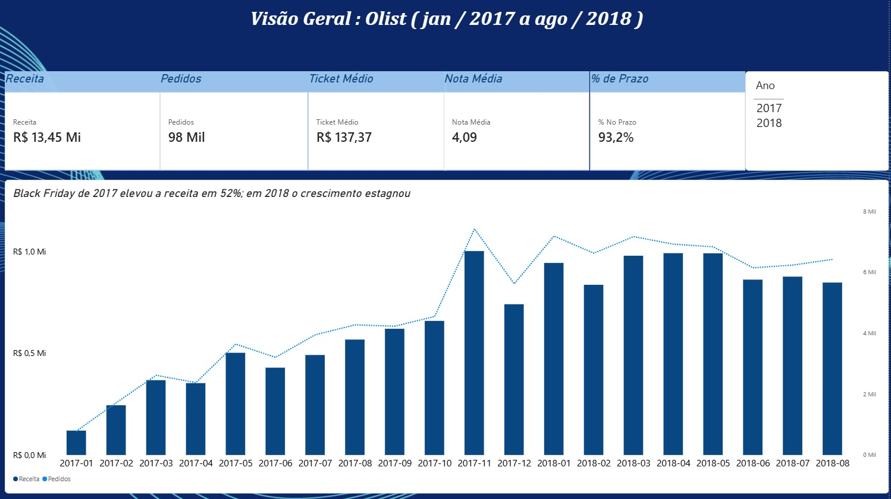
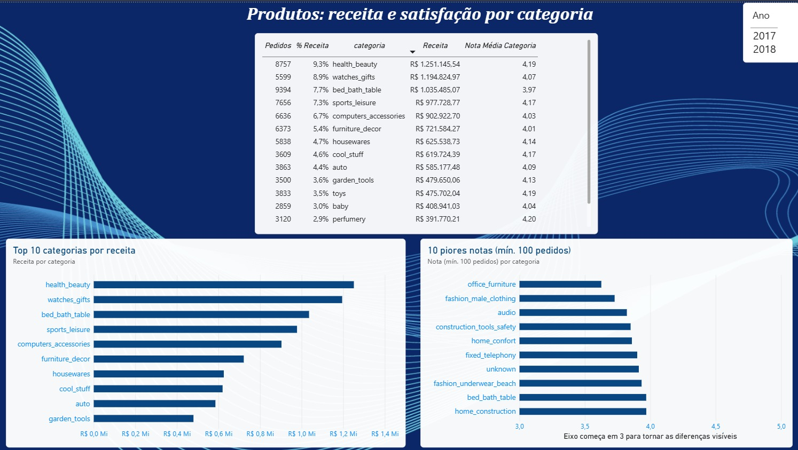
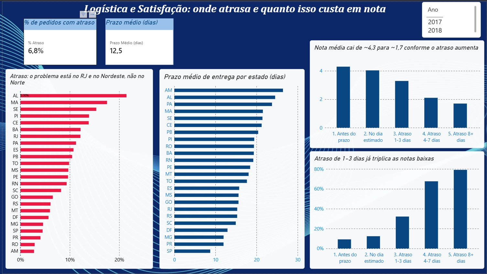
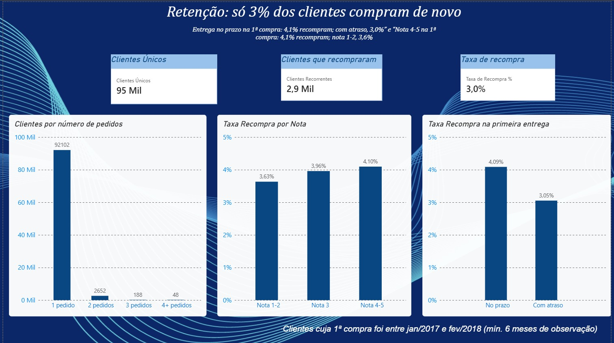

# Análise de E-commerce: Olist

Análise de vendas, produtos, logística, satisfação e retenção de clientes do marketplace brasileiro Olist, usando **SQL**, **Python** e **Power BI**.

> **Resumo em uma frase:** o crescimento do Olist estagnou em 2018 porque depende quase só de clientes novos (apenas 3% recompram), e a logística falha justamente onde há volume (Rio de Janeiro) e nas regiões onde o atraso é mais frequente (Nordeste), o que derruba as avaliações e reduz ainda mais a recompra.

## Sumário

1. [Contexto e objetivo](#contexto-e-objetivo)
2. [Dataset](#dataset)
3. [Ferramentas e fluxo de trabalho](#ferramentas-e-fluxo-de-trabalho)
4. [Decisões metodológicas](#decisões-metodológicas)
5. [Resultados](#resultados)
6. [Recomendações](#recomendações)
7. [Limitações](#limitações)
8. [Como reproduzir](#como-reproduzir)
9. [Estrutura do repositório](#estrutura-do-repositório)
10. [Dashboard](#dashboard)
11. [Autor](#autor)

---

## Contexto e objetivo

O Olist é um marketplace que conecta pequenos vendedores a grandes plataformas de venda no Brasil. O objetivo deste projeto é responder, com dados, cinco perguntas de negócio que um gestor de e-commerce faria:

1. Como evoluíram os pedidos e a receita ao longo do tempo?
2. Quais categorias geram mais receita e quais têm as piores avaliações?
3. Quanto tempo leva a entrega por estado e qual a porcentagem de pedidos com atraso?
4. O atraso na entrega derruba a nota do cliente? Em quanto?
5. Qual a taxa de recompra e a experiência da primeira compra influencia isso?

## Dataset

[Brazilian E-Commerce Public Dataset by Olist](https://www.kaggle.com/datasets/olistbr/brazilian-ecommerce) (Kaggle): cerca de 100 mil pedidos feitos entre 2016 e 2018, distribuídos em 9 tabelas relacionadas.

| Tabela | Linhas | Conteúdo |
|---|---|---|
| `orders` | 99.441 | Pedidos, status e datas |
| `order_items` | 112.650 | Itens, preço e frete |
| `order_payments` | 103.886 | Pagamentos |
| `order_reviews` | 99.224 | Avaliações dos clientes |
| `customers` | 99.441 | Clientes e localização |
| `products` | 32.951 | Produtos e categorias |
| `sellers` | 3.095 | Vendedores |
| `geolocation` | 1.000.163 | Coordenadas por CEP |
| `product_category_name_translation` | 71 | Tradução das categorias |

## Ferramentas e fluxo de trabalho

| Ferramenta | Papel |
|---|---|
| **Python** (pandas, matplotlib) | Carga dos dados, execução das consultas, gráficos e análises complementares |
| **SQL** (SQLite) | Consultas analíticas com CTEs, `JOIN`s e window functions (`LAG`, `RANK`, `ROW_NUMBER`) |
| **Power BI** | Dashboard final para quem não lê código |

Fluxo: `CSVs → SQLite → SQL → Python → Power BI`

## Decisões metodológicas

- **Receita:** soma do preço dos itens, sem frete, excluindo pedidos `canceled` e `unavailable`.
- **Período dos gráficos de vendas:** jan/2017 a ago/2018. Os meses de 2016 e set/2018 têm poucos pedidos e distorcem os percentuais de crescimento.
- **Análises de entrega:** apenas pedidos `delivered` com data de entrega preenchida.
- **Atraso:** entrega em data posterior à estimada. Compara-se apenas a data (sem horário), porque a estimativa sempre vem à meia-noite.
- **Nota do pedido:** média das avaliações do pedido, já que alguns têm mais de uma.
- **Categorias:** tradução para inglês; produtos sem categoria viram `unknown`. O ranking de notas só considera categorias com pelo menos 100 pedidos.
- **Cliente único:** `customer_unique_id`, pois o `customer_id` muda a cada pedido.
- **Coorte de recompra:** primeira compra entre jan/2017 e fev/2018, para garantir pelo menos 6 meses de observação.
- **Nulos:** os nulos em `orders` correspondem a pedidos não concluídos; em `order_reviews`, a comentários em branco (a nota está completa); em `products`, a produtos sem cadastro completo.

## Resultados

### 1. Vendas: crescimento forte em 2017 e platô em 2018


- A receita mensal foi de R$ 120 mil (jan/2017) para R$ 1,0 milhão (nov/2017), cerca de **8x**, sustentada por volume de pedidos. O ticket médio ficou estável entre R$ 125 e R$ 153.
- A **Black Friday de 2017** gerou o pico: 7.421 pedidos e R$ 1,0 milhão (+52% sobre outubro), seguido de queda de 26% em dezembro.
- Em 2018 a receita estabilizou num patamar de R$ 840 mil a R$ 990 mil por mês.

### 2. Produtos: receita distribuída, com um ponto de atenção


- As 3 maiores categorias (`health_beauty`, `watches_gifts`, `bed_bath_table`) somam cerca de 26% da receita; as 10 maiores, cerca de 62%.
- `bed_bath_table` é a 3ª em receita (R$ 1,04 mi), tem o maior volume de pedidos (9,4 mil) e nota abaixo da média (3,97).
- Categorias de móveis e casa concentram as piores notas (`office_furniture`: 3,62).

### 3. Logística: o problema não está onde parece


- O prazo médio vai de **8,8 dias em SP a 29,4 em RR**, mas prazo longo não significa atraso: as estimativas do Olist são conservadoras e as entregas chegam, em média, de 9 a 21 dias antes do prometido. O atraso geral é de ~6,8%.
- O **Rio de Janeiro** tem 12,1% de atraso em 12,3 mil pedidos (2,7x o de SP, 4,5%), com prazo médio igual ao do RS (15,3 dias), cujo atraso é de 6,1%.
- **Alagoas** tem o pior atraso do país (21,4%), seguido por MA (17,4%), SE (15,2%), PI (13,9%), CE (13,8%) e BA (12,2%).
- Estados com menos de 100 pedidos (como RR, AP e AC) têm médias pouco confiáveis.

### 4. Satisfação: o atraso derruba a nota


| Faixa de entrega | Pedidos | % de notas 1-2 |
|---|---|---|
| Antes do prazo | 88.163 | 9% |
| No dia estimado | 1.280 | 12% |
| Atraso de 1-3 dias | 1.852 | 32% |
| Atraso de 4-7 dias | 1.748 | 68% |
| Atraso de 8+ dias | 2.781 | 79% |

- A nota média cai de ~4,3 (entrega antes do prazo) para ~1,7 (8+ dias de atraso).
- Só 1 a 3 dias de atraso já triplicam as notas baixas.
- Os atrasos são ~6,7% dos pedidos, mas geram cerca de **um terço das avaliações 1 e 2**.
- **Hipótese testada:** móveis e itens de casa têm nota baixa por causa de atraso? Só em parte. Em `office_furniture`, a nota é de apenas 3,75 mesmo nos pedidos entregues no prazo, e em `bed_bath_table` vai de 4,00 para 4,14. Isso aponta para qualidade, avaria ou expectativa do cliente. Já em `audio` a logística pesa mais (nota de 3,84 sobe para 4,12 no prazo).

### 5. Retenção: quase ninguém volta


- Apenas **3,0%** dos clientes compraram mais de uma vez (4,0% na coorte com pelo menos 6 meses de observação).
- Quem recebeu a primeira compra no prazo recomprou 4,09%; com atraso, 3,05% (cerca de 25% menos).
- Por nota da primeira compra: 3,63% (nota 1-2), 3,96% (nota 3) e 4,10% (nota 4-5).
- Mesmo entre clientes satisfeitos, mais de 95% não voltam.

## Recomendações

As recomendações abaixo partem dos dados, mas são **hipóteses a testar**: as análises mostram associações, não causalidade.

### 1. Atacar o atraso no Rio de Janeiro e no Nordeste

**Evidência:** RJ tem 12,1% de atraso em 12,3 mil pedidos; AL, MA, SE, PI, CE e BA ficam entre 12% e 21%, contra 4,5% de SP.

**Ação:** investigar a causa nessas rotas (transportadora, centro de distribuição, última milha) e renegociar ou diversificar parceiros logísticos, começando pelo RJ, onde o volume é maior.

**Impacto estimado:** se o RJ chegasse ao nível de atraso de SP (4,5%), seriam cerca de **940 pedidos atrasados a menos**, aproximadamente 14% de todos os atrasos da base. Como atrasos de 8+ dias levam a 79% de notas 1-2, o efeito sobre a satisfação seria direto.

### 2. Recalibrar as estimativas de entrega com cuidado

**Evidência:** todos os estados recebem antes do prazo prometido, em média, de 9 a 21 dias.

**Ação:** testar (A/B) prazos prometidos menores nas rotas em que há folga grande, o que pode aumentar a conversão. Fazer isso de forma gradual, começando pelas rotas com atraso baixo (como o Norte), e monitorando o atraso, já que **cada atraso custa caro em nota**.

**Atenção:** reduzir prazos nas rotas com atraso alto (RJ, AL, MA) só faria sentido depois de resolver o item 1.

### 3. Investigar a qualidade em categorias com nota baixa mesmo no prazo

**Evidência:** `office_furniture` (3,75 no prazo), `bed_bath_table` (4,14 no prazo, categoria com maior volume) e outras categorias de móveis e casa ficam abaixo da referência de ~4,3 mesmo sem atraso.

**Ação:** analisar os comentários das avaliações dessas categorias para separar avaria, qualidade e expectativa, e acionar os vendedores com pior desempenho. A categoria `bed_bath_table` é prioritária pelo volume de clientes afetados.

### 4. Criar ações de retenção

**Evidência:** só 3% dos clientes recompram, e o crescimento de 2018 estagnou.

**Ação:** testar cupom ou e-mail de reengajamento após a entrega, começando por clientes com entrega no prazo e nota 4-5 (maior propensão a voltar, ~4,1%). Medir o efeito com um grupo de controle.

**Atenção:** a melhora da logística, sozinha, tem efeito limitado na recompra (a diferença entre atraso e prazo foi de ~1 ponto percentual). Retenção exige ações próprias, não só operação.

### 5. Monitorar indicadores contínuos

Acompanhar mensalmente, no dashboard: % de pedidos entregues com atraso por estado, nota média por faixa de atraso e taxa de recompra por coorte.

## Limitações

- Os resultados mostram **associação, não causalidade**: pedidos atrasados podem ter outros problemas em comum, como avaria.
- Só entram pedidos avaliados nas análises de nota. Quem avalia costuma ter uma experiência mais marcante, boa ou ruim.
- `customer_unique_id` é uma aproximação de "pessoa" e pode subestimar a recompra. O cliente também pode ter voltado a comprar fora da plataforma, o que os dados não capturam.
- Estados com poucos pedidos (RR, AP, AC) têm estatísticas pouco confiáveis.
- O dataset cobre 2016 a 2018, e o cenário atual pode ser diferente.
- Os motivos por trás da nota baixa em móveis e casa exigiriam análise de texto dos comentários, fora do escopo deste projeto.

## Como reproduzir

```bash
# 1. Clonar o repositório
git clone https://github.com/SEU_USUARIO/olist-analysis.git
cd olist-analysis

# 2. Criar e ativar o ambiente virtual
python -m venv .venv
.venv\Scripts\activate          # Windows
# source .venv/bin/activate     # Mac/Linux

# 3. Instalar as dependências
pip install -r requirements.txt

# 4. Baixar o dataset no Kaggle e colocar os 9 CSVs em data/raw/

# 5. Rodar os notebooks, na ordem, em notebooks/
#    (o primeiro cria o banco olist.db a partir dos CSVs)
```

## Estrutura do repositório

```
olist-analysis/
├── data/
│   └── raw/            # CSVs originais (não versionados)
├── notebooks/          # carga, consultas e gráficos
├── sql/                # uma consulta por pergunta de negócio
│   ├── 01_vendas_mensais.sql
│   ├── 02_categorias.sql
│   ├── 03_entregas_estado.sql
│   ├── 04_atraso_nota.sql
│   ├── 04b_categoria_atraso.sql
│   ├── 05_recompra.sql
│   └── 05b_primeira_compra.sql
├── dashboard/          # olist.pbix e prints das 4 páginas
├── images/             # gráficos usados neste README
└── README.md
```

## Dashboard

O dashboard interativo em Power BI reúne as cinco análises em quatro páginas. Para explorar o modelo de dados, as medidas em DAX e os filtros, [baixe o arquivo olist.pbix](https://github.com/KeitaUeda8/Olist-E-commerce/raw/main/dashboard/Olist_Dashboard.pbix) e abra no Power BI Desktop . Ao clicar em um estado, uma categoria ou uma barra, o restante da página se atualiza.

**Modelo de dados:** 6 tabelas relacionadas (`orders`, `order_items`, `customers`, `products`, `order_review`, `categoria_traducao`), uma tabela de calendário e uma tabela auxiliar com a primeira compra de cada cliente. As colunas e medidas seguem as mesmas regras das consultas em SQL, e os valores foram conferidos contra elas.

### Página 1: Visão Geral



Receita, pedidos, ticket médio, nota média e % de entregas no prazo, com a evolução mensal de receita e pedidos (jan/2017 a ago/2018) e filtro por ano.

### Página 2: Produtos



Ranking das categorias por receita, com participação no total e nota média, e as 10 categorias com pior nota (mínimo de 100 pedidos).

### Página 3: Logística e Satisfação



Prazo médio e % de atraso por estado (estados com menos de 100 pedidos entregues não aparecem), e a nota média e o % de notas 1-2 por faixa de atraso.

### Página 4: Retenção



Taxa de recompra, distribuição de clientes por número de pedidos e taxa de recompra por entrega e por nota da primeira compra.

**Observações sobre os números do dashboard:**

- As páginas 1 a 3 consideram o período jan/2017 a ago/2018, enquanto algumas análises deste README usam todos os pedidos. Por isso pode haver diferenças pequenas.
- No dashboard, a nota média é calculada por avaliação, e nas consultas em SQL, por pedido.
- A página 4 não usa filtro de período. Os dois gráficos de recompra por primeira compra usam a coorte jan/2017 a fev/2018 (taxa de ~4,0%), e os cartões usam todos os clientes (3,0%).
- O gráfico de recompra por primeira compra lê `data/processed/primeira_compra.csv`, gerado no notebook da Pergunta 5. Os dados já estão embutidos no `.pbix`, então o arquivo abre sem precisar de nada além dele.

## Autor

Gabriel Keita Ueda: analista de dados júnior

[LinkedIn](https://www.linkedin.com/in/gabriel-ueda-dados/) · [GitHub](https://github.com/KeitaUeda8)
